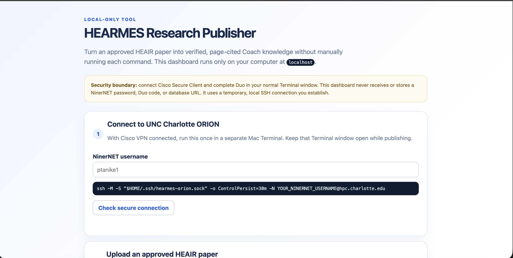

# Project HEARMES

The **Project HEARMES** platform evaluates organizational readiness for responsible AI integration in higher education. It provides a structured, role-adaptive assessment framework that turns readiness data into actionable coaching insights.

Working backend for role-adaptive Higher Education AI Readiness and Maturity Evaluation System assessments. The draft instrument is seeded as four dimensions, seventeen sub-dimensions, and 102 role-specific metric questions across Student, Faculty, Executive Leadership, Administrative Staff, Programming Staff, and Finance Staff.

---

## Take the Assessment

Want to see how AI-ready your organization is?

**[Take the Project HEARMES Assessment](https://tanikellapratik23.github.io/heair-readiness-platform)**

- **Role-specific instrument**: Questions use their appropriate awareness, frequency, confidence, likelihood, importance, or agreement metric scale.
- **Instant AI Score & Coaching Response**: Receive a customized, AI-generated breakdown tailored to your results, highlighting key strengths and immediate steps for growth.

---

## Features

- **Interactive Assessment Interface**: Role-adaptive diagnostic hosted via GitHub Pages.
- **AI Score Coaching Chat**: Real-time, context-aware AI coaching and personalized feedback based on user scores.
- **Modular Architecture**: Scalable routing system designed for fast evaluation and seamless integration.

---

## Importing an approved HEAIR paper into Coach retrieval

The live Coach starts with a compact curated HEAIR framework corpus. To add an approved full paper to the existing Neon/PostgreSQL retrieval path, extract its text locally, review the page text, then run the explicit admin import. The PDF, extracted text, and generated inputs are intentionally ignored by Git.

```sh
# On a trusted machine with the database connection configured.
python3 -m pip install pypdf
python3 scripts/extract-heair-pdf.py /absolute/path/HEAIR.pdf /private/path/heair-pages.json
npm run knowledge:import:heair-paper -- --input /private/path/heair-pages.json --dry-run
npm run knowledge:import:heair-paper -- --input /private/path/heair-pages.json
```

The importer replaces the prior full-paper import with a deterministic set of page-aware chunks. It does not alter assessment scores, user data, or the existing 13 curated framework chunks. Verify several Coach queries and their displayed page/section citations before treating the full paper as production-ready.

### Optional ORION build, then Neon import

ORION can prepare the same retrieval artifact offline through Slurm. The live site does **not** contact ORION or scratch storage. The scheduled job writes a validated JSON artifact to durable ORION home storage; copy that artifact to a trusted Mac, then explicitly import it into Neon.

On the **ORION login node** (development/setup only), clone or update the repository in `/users/<NinerNET>/`, then prepare the PDF-only Python environment:

```sh
module load node.js/22.20.0
cd /users/<NinerNET>/hearmes-orion
git switch main && git pull --ff-only
npm ci && npm run db:generate
python3 -m venv .venv-pdf
.venv-pdf/bin/python -m pip install pypdf
mkdir -p /users/<NinerNET>/hearmes-artifacts /users/<NinerNET>/hearmes-logs
```

Upload an approved PDF to `/users/<NinerNET>/hearmes-inputs/` first. Then submit the **scheduled compute job** (the known `Orion` CPU partition is shown; adjust only if URC directs you to another approved resource):

```sh
export HEARMES_REPO=/users/<NinerNET>/hearmes-orion
export HEARMES_PDF=/users/<NinerNET>/hearmes-inputs/HEAIR.pdf
export HEARMES_OUTPUT=/users/<NinerNET>/hearmes-artifacts/heair-paper-v1.artifact.json

sbatch --partition=Orion --cpus-per-task=1 --mem=2G --time=00:10:00 \
  --output=/users/<NinerNET>/hearmes-logs/heair-paper-%j.out \
  --error=/users/<NinerNET>/hearmes-logs/heair-paper-%j.err \
  scripts/orion/build-heair-paper-artifact.slurm
```

After Slurm reports `COMPLETED` with exit code `0`, copy the artifact from durable ORION home storage to a trusted Mac using `scp`. On the **Mac**, validate the artifact before the real import:

```sh
npm run knowledge:import:heair-paper -- --artifact /private/path/heair-paper-v1.artifact.json --dry-run
```

Then set `DATABASE_URL` only in the current terminal session and run the same command without `--dry-run`. The importer verifies schema, page count, chunk indexes, and an integrity checksum before replacing the prior full-paper import in Neon.

## HEARMES-Research-Publisher

HEARMES-Research-Publisher is a local-only dashboard for turning approved research PDFs into validated, page-cited shared knowledge for the HEARMES AI Coach. It replaces the repeated `scp`, `ssh`, `sbatch`, artifact-download, validation, and database-import commands with a guided browser flow. It binds only to `127.0.0.1`; it is not a public Render feature or public upload endpoint.



### What it does

1. Stores the selected PDF temporarily on the researcher’s Mac.
2. Securely copies it to the researcher’s ORION home storage after the researcher completes VPN and Duo authentication through the normal UNC Charlotte tools.
3. Submits a CPU Slurm job that extracts text, creates page-aware chunks, and writes a versioned retrieval artifact.
4. Monitors the job, copies the completed artifact back to the Mac, and validates its schema, page count, chunk indexes, and integrity checksum.
5. Enables an explicit import into Neon only after validation. The live Coach can then retrieve the paper and display its title, citation, and PDF page in source cards.

### Security boundary

- The dashboard never requests, stores, or transmits a NinerNET password, Duo code, VPN credential, or Neon connection string.
- Cisco Secure Client and Duo happen only in the user’s normal Terminal/SSH flow.
- The Neon `DATABASE_URL` is supplied only to the local Terminal session that launches the dashboard; it never appears in the web form.
- Publish only approved, non-sensitive shared research sources. Never publish participant data, student records, private Coach uploads, chat history, passwords, or confidential institutional material into the shared corpus.

### First-time ORION setup — Terminal 1

Connect Cisco Secure Client first. Then sign in to ORION normally and complete Duo:

```sh
ssh <NinerNET>@hpc.charlotte.edu
```

On the ORION login node, run this setup once. Replace `<NinerNET>` with your username:

```sh
cd /users/<NinerNET>
git clone https://github.com/tanikellapratik23/heair-readiness-platform.git hearmes-orion
cd hearmes-orion
git switch main
module load node.js/22.20.0
npm ci
npm run db:generate
python3 -m venv .venv-pdf
.venv-pdf/bin/python -m pip install pypdf
mkdir -p /users/<NinerNET>/hearmes-inputs /users/<NinerNET>/hearmes-artifacts /users/<NinerNET>/hearmes-logs
```

If the ORION copy already exists, update it before using a newly added Publisher feature:

```sh
cd /users/<NinerNET>/hearmes-orion
git switch main
git pull --ff-only
module load node.js/22.20.0
npm ci
npm run db:generate
```

### Publish workflow — three windows

#### Terminal 1: secure ORION connection

Keep Cisco Secure Client connected. On your Mac, establish this temporary connection and complete Duo when prompted. Keep this Terminal window open while publishing:

```sh
ssh -M -S "$HOME/.ssh/hearmes-orion.sock" -o ControlPersist=30m -N <NinerNET>@hpc.charlotte.edu
```

#### Terminal 2: launch the local dashboard

On your Mac, update the local repository, then securely set `DATABASE_URL` for this one Terminal session. Do not paste the connection string into the browser:

```sh
cd "/Users/pratiktanikella/Documents/Codex/2026-07-28/heair-readiness-platform-backend-specification-purpose"
git pull --ff-only
npm ci

read -r -s 'DATABASE_URL?Paste Neon DATABASE_URL: '
echo
export DATABASE_URL

npm run research:publisher
```

Open [http://127.0.0.1:3060](http://127.0.0.1:3060). The browser tab uses the same Project HEARMES favicon as the public platform.

#### Terminal 3: optional ORION maintenance or troubleshooting

This third Terminal is only needed to update the ORION repository, inspect files, or troubleshoot a job while the dashboard runs. It reuses the already-authenticated secure connection:

```sh
ssh -S "$HOME/.ssh/hearmes-orion.sock" <NinerNET>@hpc.charlotte.edu
cd /users/<NinerNET>/hearmes-orion
```

### In the dashboard

1. Enter your NinerNET username and click **Check secure connection**.
2. Choose the source category, exact title, citation/DOI/stable reference, and approved PDF.
3. Click **Prepare source**, then **Submit to ORION**.
4. Click **Refresh status** until the artifact is validated.
5. Click **Import verified artifact into Coach**. This is intentionally separate from processing so a researcher reviews the source before it affects the live Coach.
6. Ask the Coach a question about the paper and confirm the displayed source title and PDF page citation.

### Source categories and replacement behavior

- **Full HEAIR paper:** replaces only the existing full-HEAIR-paper record.
- **Research paper:** creates a separate shared RAG source.
- **Best-practice guidance:** creates a separate shared RAG source.

Each non-HEAIR source has a deterministic identity based on its title and citation. Re-publishing a revised copy with the same title and citation replaces only that paper’s chunks; it does not overwrite HEAIR or other papers.

### Troubleshooting

- **“Secure ORION connection is unavailable”:** confirm Cisco VPN is connected, rerun Terminal 1, complete Duo, and keep that window open.
- **Publisher reports a missing ORION script:** use Terminal 3 to update `/users/<NinerNET>/hearmes-orion` from `main`.
- **The import button says `DATABASE_URL` is unavailable:** close the Publisher and relaunch it through Terminal 2 after setting the variable with the hidden prompt.
- **Slurm job fails:** use Terminal 3 and inspect `/users/<NinerNET>/hearmes-logs/`; do not import the artifact.
- **PDF has no extractable text:** use an approved text-searchable PDF or prepare reviewed OCR text before publishing.
